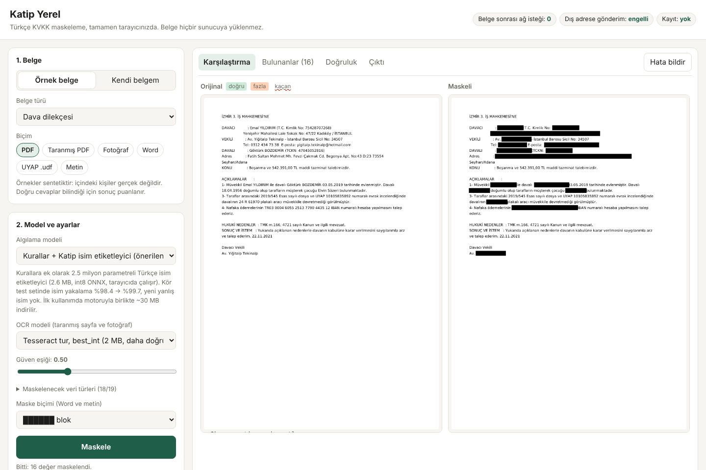

# Katip Yerel

Turkish KVKK redaction that runs **entirely in the browser**. The document is opened, analysed,
masked and leak-checked inside the tab; nothing is uploaded or stored, and the page's
Content-Security-Policy blocks sending data to any other origin.



- **Live demo:** https://fikrifirat.github.io/katip/ (GitHub Pages, `docs/`) and the Hugging Face Space `fikrifirat/katip-yerel`
- **Model:** [`katip-tr-name-tagger-tiny`](hf/model/README.md), 2.6 MB int8 ONNX, runs in the tab.
  Blind-set name recall 98.4% → 99.7% with no new false names.

## What runs where

| Step | Component |
| --- | --- |
| Detection rules | Katip's `recognizers.py` + word lists, unchanged, in Pyodide (CPython → WASM) |
| Name tagger | tiny BERT via transformers.js 4 / ONNX Runtime Web, merged with the rules (`src/py/local_detect.py`) |
| .txt, UYAP .udf, .docx | stdlib Python in Pyodide (`src/py/local_formats.py`) |
| PDF | MuPDF.js: real glyph removal with `applyRedactions`, metadata scrubbed |
| Scans and photos | tesseract.js 7, Turkish `best_int` or standard model |
| Leak check | output re-read (text layer or a second OCR pass) for every masked value |

## Demo features

- 16 synthetic sample documents (petition, judgment, lease, epikriz, chat log, …) in up to six formats,
  scored live against their answer keys: recall, precision, misses, partial masks, false alarms.
- Model picker, OCR model, confidence threshold, data types, mask style.
- Before/after page view, per-item review with toggles, extra terms, download.
- **Report a mistake:** builds a `katip-rapor-*.zip` (settings, scores, masked output; detected values
  and the original only with the user's tick) and opens an e-mail draft to the address in
  `src/config.js`. Set `reportEndpoint` there (e.g. a Formspree form) to add one-click sending; the
  build adds only that origin to the CSP.

## Build

```bash
npm install                                   # pyodide, mupdf, tesseract.js, transformers.js, jszip
python3 src/build_site.py <path-to-katip-redact> node_modules docs --source https://github.com/fikrifirat/katip
python3 docs/serve.py                         # http://127.0.0.1:8765
```

`build_site.py` copies the detection code straight from the Katip server repository (one source of truth)
and the sample documents from its `eval/blind` set.

**GitHub Pages:** Settings → Pages → Deploy from a branch → `main` / `docs`.
**Hugging Face:** `./publish_hf.sh` (after `hf auth login`) uploads the model and the static Space.

## Tests

| Script | Checks |
| --- | --- |
| `src/tests/parity.mjs` + `parity_server.py` | browser rules = server `analyzer.detect`, span by span (0 diffs on 1,803 spans) |
| `src/tests/tests_parity_tagger.cjs` + `ml/parity_py.py` | browser tagger = Python onnxruntime (0 diffs on 152 spans) |
| `src/tests/tests_e2e_demo.cjs` | Chromium: every format, report flow, 0 requests to other origins |
| `ml/eval_system.py` | rules vs rules + tagger on blind / held-out / negatives |

## Training the tagger

```bash
python3 ml/gen_train.py <katip-redact> ml/train.jsonl 8000 12
python3 ml/gen_train.py <katip-redact> ml/dev.jsonl 400 98
python3 ml/train.py ml/train.jsonl ml/dev.jsonl ml/model      # ~6 min on 4 CPU cores
python3 ml/eval_system.py ml/model <katip-redact>/eval/blind --q8
```

## Licences

Katip code: Apache-2.0. This demo bundle includes **MuPDF (AGPL-3.0)**, so the bundle as distributed
here is AGPL-3.0 and its full source is this repository. Closed-source or commercial redistribution
needs an Artifex commercial licence. Pyodide MPL-2.0, tesseract.js and the `tur` model Apache-2.0,
transformers.js Apache-2.0, ONNX Runtime MIT, `common_words.txt` from the OpenSubtitles frequency list
CC BY-SA 4.0. Sample documents are synthetic; any resemblance to real people is accidental.
