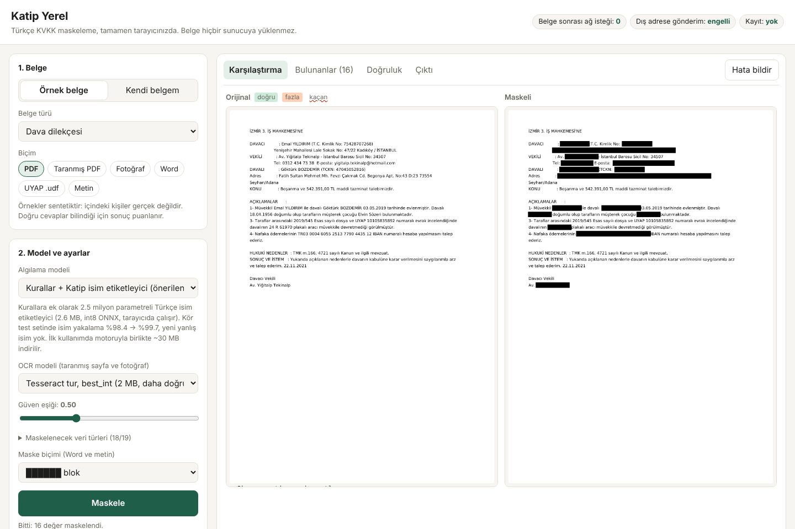
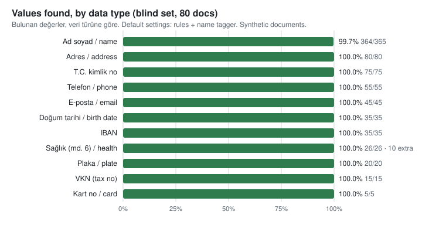
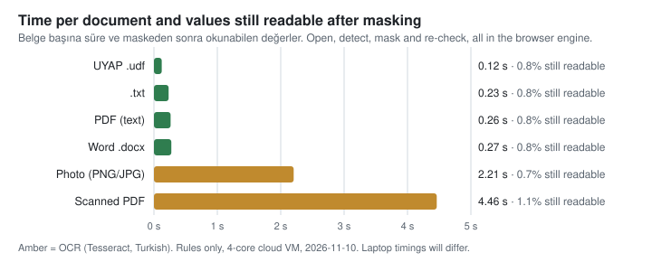

# Katip Mask: tarayıcıda çalışan KVKK maskeleme

[English](README.md) · **Türkçe**

Katip, Türkçe hukuk belgelerindeki kişisel verileri (T.C. kimlik no, VKN, IBAN, telefon, e-posta,
plaka, adres, ad soyad, KVKK md. 6 sağlık verileri) bulur ve maskeler; **belge bilgisayarınızdan hiç
çıkmaz**. Dosya tarayıcı sekmesinin içinde açılır, incelenir, maskelenir ve sızıntı kontrolünden
geçer. Hiçbir şey yüklenmez veya saklanmaz; sayfanın güvenlik politikası (CSP) başka bir adrese veri
gönderilmesini engeller. Bilgisayardan yalnızca indirdiğiniz maskelenmiş kopya çıkar.

Dava dosyalarını, sözleşmeleri veya mahkeme belgelerini müvekkil, bilirkişi ya da yapay zekâ
araçlarıyla KVKK'ya uygun paylaşması gereken hukuk büroları, şirket hukuk ve uyum ekipleri için.

## Temel sonuçlar

Katip'in sentetik Türkçe hukuk belgeleri üzerinde ölçüldü. **Kör set**, geliştirme ve eğitim
sırasında hiç görülmemiş isimler içeren 16 belge türünde (4'ü yeni) 80 belgedir.

| | Sonuç |
| --- | --- |
| Bulunan değerler (kör set, varsayılan ayarlar) | **757'de 756 (%99,9)**; 10 fazladan işaretleme, hepsi sağlık terimi |
| Bulunan isimler | 365'te 364 (%99,7) |
| Maskeden sonra hâlâ okunabilen değerler (uçtan uca, yalnızca kurallar) | metin, PDF, Word ve UDF'de %0,8; fotoğraf ve taramalarda %0,7–1,1 |
| İsim içermeyen hukuk metninde yanlış alarm | 3 belgede toplam 3 |
| Belge başına süre | metin, PDF, Word, UDF'de 0,1–0,3 sn; OCR ile 2–4,5 sn (4 çekirdekli bulut sunucusu) |
| Belge açıldıktan sonra yapılan ağ isteği | **0** (Chromium'da doğrulandı) |
| İlk yükleme | motor dosyaları (Python, PDF, OCR) yaklaşık 30 MB, isim etiketleyici için yaklaşık 30 MB daha; sonra tarayıcı önbelleğinde kalır |

### Demodaki modeller

| Model | Nedir | Bulunan değer (kör set) | Bulunan isim |
| --- | --- | --- | --- |
| **Katip Mask Nano · tr v1.1** (önerilen) | Katip Kural + [`katip-mask-nano`](https://huggingface.co/f1k/katip-mask-nano), 2,5 MB, Türk ve yabancı müvekkil isimleri | **757'de 756 (%99,9)** | 365'te 364 |
| **Katip Kural** | Katip'in Türkçe kuralları v0.2, 0,3 MB | 757'de 756 (%99,9) | 365'te 364 |
| Vanilla: kvkk-pii | açık kaynak [kvkk-pii](https://pypi.org/project/kvkk-pii/) 0.2 regex katmanı, varsayılan ayarlar (karşılaştırma) | 757'de 183 (%24,2) | 365'te 0 |
| **Katip Mask Base** | Katip Kural + [`katip-mask-base`](https://huggingface.co/f1k/katip-mask-base), 110,8 MB, isim + adres + sağlık terimleri; yalnızca [Space'te](https://huggingface.co/spaces/f1k/katip-mask) | **757'de 757 (%100)** | **365'te 365** |

**Katip Mask Nano v1.1** (14 Kasım 2026) Türk belgelerinde geçtiği haliyle yabancı müvekkil isimleriyle eğitildi.
Kurallar kör setteki değerlerin neredeyse hepsini yakaladığı için farkı zor metinde görülüyor: gerçek Yargıtay
cümlelerine yerleştirilen, eğitimde görülmemiş yabancı isimlerin %94,6'sını [92,5–96,2] buluyor (v1 %80,3, kurallar
%77,1), aynı yerlerdeki Türk isimlerin %98,7'sini. Bedeli: isim gibi görünen sözcüklerle dolu tuzak metinde 1.000
sözcükte 9 yanlış isim (v1: 0,6). Ayrıntılar: [model kartı](https://huggingface.co/f1k/katip-mask-nano),
[`lab/foreign`](lab/foreign/README.md).

**Katip Mask Base, model tek başına** (kurallar olmadan); BERTurk'ten 8.000 sentetik belgeyle bir
Mac'te 25,5 dakikada ince ayarlandı:

| Set | İsimler | Adresler | Sağlık terimleri | Fazladan |
| --- | --- | --- | --- | --- |
| Kör (80 belge) | 365'te 364 | 80'de 80 | 26'da 26 | 2 |
| Ayrılmış (60 belge) | **275'te 275** (kurallar + tiny: 268) | 70'te 70 | 26'da 26 | 0 |
| İsim içermeyen hukuk metni | | | | **0** (kurallar + tiny: 3) |

**Tüm akış** (demodaki gibi kurallar + Katip Mask Base, [`metrics/accuracy-berturk.json`](metrics/accuracy-berturk.json)):
kör setteki tüm değerler (757'de 757, isimler 365'te 365, bir fazladan isim işareti) ve ayrılmış setteki
tüm değerler (618'de 618; Nano v1.1: 614). İsim içermeyen metinde yanlış alarm Nano ile aynı, 3. Bunun için tek bir
ayar gerekiyor: BERTurk'ün %90 ve üzeri güvenle bulduğu isimler olduğu gibi tutulur. Bu ayar olmadan, küçük
etiketleyici için yazılan birleştirme kuralları *Esila* gibi aynı zamanda sıradan sözcük olan adları atıyordu
ve sonuç Nano ile aynıydı ([`accuracy-berturk-no-trust.json`](metrics/accuracy-berturk-no-trust.json)).
%90 değeri bu ölçümden önce bir kez belirlendi, ayarlanmadı; ayrılmış set geliştirme sırasında incelenmişti, kör set incelenmemişti.

Katip Mask Nano'dan 40 kat büyük olduğu için demoda varsayılan Nano olarak kalıyor; Katip Mask Base Hugging Face
Space'te çalışıyor (110,8 MB'lık dosyası GitHub Pages'in 100 MB sınırını aşıyor). Ham veriler:
[`metrics/berturk-model-alone.json`](metrics/berturk-model-alone.json).

### Boyut, hız ve doğruluk yan yana

| | İndirme | Belge başına tespit süresi (metin, OCR yok) | Kör set | Ayrılmış set |
| --- | --- | --- | --- | --- |
| Vanilla kvkk-pii | 0,1 MB | 1 ms | 757'de 183 (%24,2) | 618'de 154 |
| Katip Kural | 0,3 MB | 3 ms | 757'de 756 (%99,9) | 618'de 606 |
| Katip Mask Nano v1.1 | + 2,5 MB | 7 ms | 757'de 756 (%99,9) | 618'de 614 |
| Katip Mask Base | + 110,8 MB | 28 ms | **757'de 757 (%100)** | **618'de 618** |

**Küçültme.** İki model de int8 ONNX olarak dağıtılıyor: Katip Mask Nano 10,0 → 2,6 MB, Katip Mask Base 440,3 → 110,8 MB
(ikisi de 4 kat küçük). Yukarıdaki tüm skorlar int8 dosyalarla ölçüldü; küçültme doğruluktan bir şey
götürmedi. OCR'da küçük Türkçe model 7,7 MB yerine 2 MB ve bulma oranı neredeyse aynı (96 taramada 49'a karşı 48 kaçan).
**Süreler** Python onnxruntime ile; Nano ve kurallar 4 çekirdekli bulut sunucusunda, Katip Mask Base Apple silikon
Mac'te ölçüldü. Tarayıcı süreleri (WebAssembly, tek iş parçacığı) daha yavaştır ve henüz ölçülmedi.
BERTurk'ü GitHub Pages'e sığacak boyuta damıtmak yol haritasında.

<picture>
  <source media="(prefers-color-scheme: dark)" srcset="metrics/accuracy-dark.svg">
  
</picture>

<picture>
  <source media="(prefers-color-scheme: dark)" srcset="metrics/speed-dark.svg">
  
</picture>

**Bu sonuçların henüz göstermedikleri.** Belgelerin hepsi sentetiktir ve kör setteki 16 belge
türünün 12'si eğitim verisiyle aynı şablonları paylaşır; gerçek dava dosyalarında sonuçlar daha
düşük olacaktır. Süreler tipik bir dizüstü bilgisayardan değil, bulut sunucusundan alınmıştır. Ham
veriler: [`metrics/`](metrics/). Betikler: `ml/benchmark.py`, `ml/make_charts.py`. Gerçek
belgelerle ölçmemize yardım edin: [İletişim](#sorular-pilot-ve-iletişim).

## Katip'in temel modellere kattıkları

| Temel | Tek başına | Katip ile (ölçülen, kör set) |
| --- | --- | --- |
| [kvkk-pii](https://pypi.org/project/kvkk-pii/) 0.2, açık kaynak Türkçe kişisel veri regex'i | 757'de 183 değer (%24,2), 365'te 0 isim | 757'de 756 (%99,9), 365'te 364 isim |
| Katip'in kendi kuralları | 365'te 359 isim (%98,4) | 2,6 MB etiketleyiciyle 365'te 364, yeni yanlış isim yok |
| [BERTurk](https://huggingface.co/dbmdz/bert-base-turkish-cased) | kişisel veri etiketi olmayan bir dil modeli | Katip kurallarıyla 757'de 757 değer; tek başına: isim 365'te 364, adres 80'de 80, sağlık terimi 26'da 26 |
| Tesseract `tur` | yalnızca metin; değerin gerçekten silindiği kontrol edilmez | maskelenen her değer çıktının ikinci bir OCR okumasında yeniden aranır; küçük OCR modeli 4 kat küçük, bulma oranı neredeyse aynı (96 taramada 49'a karşı 48 kaçan) |

**Sırada:** demoya ikinci karşılaştırma olarak hazır bir Türkçe NER modeli eklemek, BERTurk'ü GitHub
Pages'e sığacak kadar küçük bir modele damıtmak ve tüm ölçümleri pilot bürolardan izinli gerçek belgelerle tekrarlamak.

## Desteklenenler

| Belge | Yöntem |
| --- | --- |
| Metin katmanlı PDF | kutunun altındaki karakterler gerçekten silinir (MuPDF `applyRedactions`), meta veriler temizlenir |
| Taranmış PDF, fotoğraf (PNG, JPG) | OCR (basılı taramada Tesseract, el yazısı ve telefon fotoğrafında PaddleOCR), kutular görüntüye işlenir |
| Word `.docx` | metin, izlenen silmeler, yorum yazarları ve belge özellikleri maskelenir |
| UYAP `.udf` | yerinde maskelenir, geçerli bir UDF olarak kalır |
| Düz metin | |

| Veri türü | Tespit |
| --- | --- |
| T.C. kimlik no, VKN, IBAN, kart numarası | sağlama (checksum) doğrulamalı kalıplar |
| Telefon, e-posta, plaka, doğum tarihi | bağlam sözcükleriyle Türkçe biçimler |
| Adres | Türk adres yapısı (Mh., Cd., Sk., No, ilçe/il) |
| Ad soyad | isim listeleri, ipucu sözcükler (Av., Sayın, davacı …), büyük harf ve ek kuralları, ayrıca cihaz üzerinde çalışan isim etiketleyici |
| KVKK md. 6 özel nitelikli veriler (sağlık, sendika …) | sözlük, incelemeye işaretlenir |

Denendiği belge türleri: dilekçe, karar, kira ve iş sözleşmesi, fatura, aydınlatma metni,
vekâletname, ihtarname, mektup, e-posta, duruşma tutanağı, mesajlaşma kaydı, epikriz ve bilirkişi raporu.

## Deneyin

- **Demo:** https://fikrifirat.github.io/katip/ (veya [Hugging Face Space](https://huggingface.co/spaces/f1k/katip-mask)).
  16 örnek belgeden birini seçip cevap anahtarına göre bulma oranını, isabeti, kaçanları ve yanlış
  alarmları canlı görün ya da kendi dosyanızı açın.
- Belge seçer seçmez görünür; bulunan değerler sayfanın üzerinde işaretlenir.
- Tek inceleme ekranı: her değeri sayfada veya listede açıp kapatın, kaçanları ekleyin, sonra
  **Maskeleri uygula** ve indirin. Maske rengini, isteğe bağlı tek satırlık filigranı ve her sayfanın ortasına isteğe bağlı Katip logosunu (PDF ve görüntüler) seçin.
- Tespit modelini, OCR modelini, güven eşiğini ve veri türlerini değiştirin; arayüz Türkçe ve İngilizce.
- **Hata bildir** küçük bir rapor hazırlar (ayarlar, skorlar, maskelenmiş çıktı; orijinal yalnızca
  siz işaretlerseniz) ve bir e-posta taslağı açar.

## Nasıl çalışır

| Adım | Bileşen |
| --- | --- |
| Tespit kuralları | Katip'in Python tanıyıcıları ve sözcük listeleri, değiştirilmeden, Pyodide içinde (WebAssembly'ye derlenmiş Python) |
| İsim etiketleyici | [`katip-mask-nano`](https://huggingface.co/f1k/katip-mask-nano), 2,5 MB int8 ONNX, transformers.js; ya da [`katip-mask-base`](https://huggingface.co/f1k/katip-mask-base) (isim, adres, sağlık), 110,8 MB |
| Metin, UDF, Word | Pyodide içinde standart kütüphane Python (`src/py/local_formats.py`) |
| PDF | MuPDF.js |
| Tarama ve fotoğraf | Türkçe modelle tesseract.js; tükenmez kalem izi olan ya da fotoğraftan kesilen sayfalarda PaddleOCR PP-OCRv5 (küçük algılayıcı + Latin okuyucu, 13 MB ONNX) ([lab/ocr_bench](lab/ocr_bench/README.md)) |
| Sızıntı kontrolü | çıktı her maskelenen değer için yeniden okunur (metin katmanı veya ikinci OCR) |

Tarayıcıdaki kurallar Katip'in sunucu motoruyla birebir aynı sonucu verir (1.803 değerde 0 fark);
tarayıcıdaki etiketleyici Python onnxruntime ile aynıdır (152 değerde 0 fark; hem yalnız isim hem çok
türlü model kodu için).

## Yol haritası

- [x] PDF, tarama, fotoğraf, Word, UDF ve metin için tamamen tarayıcıda maskeleme
- [x] Cihaz üzerinde isim etiketleyici, herkese açık demo, Hugging Face Space ve model
- [x] İsim, adres ve sağlık terimleri için BERTurk modeli ([`ml/berturk/`](ml/berturk/))
- [x] BERTurk ile tüm akış: kör sette 757'de 757
- [ ] GitHub Pages'e sığan daha küçük (damıtılmış) BERTurk
- [ ] Demoda ikinci karşılaştırma olarak hazır bir Türkçe NER modeli
- [ ] Pilot bürolardan, izinli gerçek belgelerle değerlendirme
- [ ] Dizüstü ve telefon süreleri; daha küçük ilk indirme
- [ ] Kurum ve mahkeme adları, esas/karar numaraları, daha fazla KVKK md. 6 kategorisi
- [ ] Excel, e-posta (`.eml`, `.msg`) ve klasörle toplu işlem
- [ ] Çevrimdışı kullanım için tarayıcı eklentisi ve masaüstü uygulaması

## Sorular, pilot ve iletişim

- Sorular, kaçan maskelemeler, öneriler: [issue açın](https://github.com/fikrifirat/katip/issues/new/choose).
  Lütfen gerçek kişisel veri paylaşmayın; demodaki *Hata bildir* düğmesini veya sahte değerleri kullanın.
- Büronuzda pilot, entegrasyon veya ticari lisans: **fikrifirat@gmail.com**.

## Geliştirme

Derleme, test ve eğitim adımları için [İngilizce README](README.md#develop).

## Lisans

Kod ve demo: **[AGPL-3.0](LICENSE)**; AGPL'nin kaynak kodu paylaşma yükümlülüğü olmadan ürünlerde,
kurum içi sistemlerde veya çevrimiçi hizmetlerde kullanım için **ticari lisans** vardır, bkz.
[COMMERCIAL.md](COMMERCIAL.md). Modeller: CC BY-NC 4.0.

Üçüncü taraf bileşenler: MuPDF (AGPL-3.0, Artifex), kvkk-pii (MIT, Aleonis; yalnızca karşılaştırma), Inter ve Space Grotesk yazı tipleri (SIL OFL 1.1), Pyodide (MPL-2.0), tesseract.js ve `tur` modeli
(Apache-2.0), PaddleOCR PP-OCRv5 modelleri (Apache-2.0, PaddlePaddle), transformers.js (Apache-2.0), ONNX Runtime (MIT), OpenSubtitles sıklık listesinden
`common_words.txt` (CC BY-SA 4.0). Örnek belgeler sentetiktir; gerçek kişilerle benzerlik tesadüfidir.
